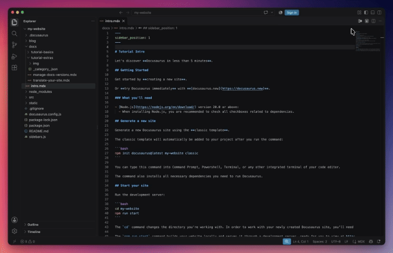
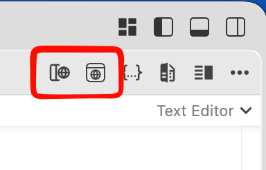

# Local Preview

✨ Preview your site locally, right within VS Code. ✨

Run a webserver under the hood and see the generated page in a live view while you
browse and edit the source. Especially useful for Markdown-based documentation sites.



## Features

- Maps files in your workspace to local server URLs. For example, `docs/page.md` to
  `http://localhost:3000/docs/page.html`.
- Opens it in a live split pane next to your editor, or in a separate floating window.
- Starts your server automatically when a preview opens, in a terminal or in the background.
- Follow mode: the preview follows your editor, with varying levels of auto-navigation.
  See [Follow mode](#follow-mode).

| Command                             | Shortcut     |
| ----------------------------------- | ------------ |
| `Local Preview: Open in Split Pane` | `Ctrl+Alt+L` |
| `Local Preview: Open in Window`     | `Ctrl+Alt+O` |
| `Local Preview: Add Mapping`        | –            |
| `Local Preview: Stop Server`        | –            |

Both open commands are also available in the editor title bar.

## Setup

1. Open the VS Code settings and search for `localpreview`.
2. To start your server automatically, set **Server: Command** and **Server: Port**.
3. In **Mappings**, add at least one mapping for your files. See below for an example.
4. Open any file that matches your mapping and click **Open in Split Pane** or **Open
   in Window** in the editor title bar.



### Example

This example uses a [Docusaurus](https://docusaurus.io/) site. `yarn start --no-open`
starts its dev server without opening a browser, and the server serves the site at
`http://localhost:3000`. The Markdown files live in the `docs` folder.

Configure the extension like this:

```json
{
  "localPreview.server.command": "yarn start --no-open",
  "localPreview.server.port": 3000,
  "localPreview.mappings": [
    { "pattern": "^docs/(.*)\\.mdx?$", "url": "http://localhost:3000/docs/$1.html" }
  ]
}
```

## Follow mode

The preview can navigate on its own as you work in the editor. Set **Follow Mode**
(`localPreview.followMode`) to choose how much, from no auto-navigation at all to maximum
auto-navigation. Each step adds to the one before:

| Mode                                         | What the preview does                                                                                   |
| -------------------------------------------- | ------------------------------------------------------------------------------------------------------- |
| Off                                          | Nothing. The preview only changes when you browse it yourself.                                          |
| Follow files                                 | Shows whichever file you switch to.                                                                     |
| Follow files and Markdown headings           | Also scrolls to a heading when your cursor lands on it. Elsewhere in the file, it stays where it is.    |
| Follow files, Markdown headings, and content | Also scrolls to the closest heading above your cursor, so the preview tracks where you are in the text. |

More navigation is more convenient, because the preview always shows what you are working
on. It can also be more distracting, because the page moves while you type and browse.
Start with the mode you like best and move up or down until it feels right.

## Configuration

| Setting                               | Default   | Description                                                                                                                                                                                      |
| ------------------------------------- | --------- | ------------------------------------------------------------------------------------------------------------------------------------------------------------------------------------------------ |
| `localPreview.mappings`               | `[]`      | List of `{ pattern, url }`. `pattern` is a regex tested against the workspace-relative path, then the absolute path (forward slashes). First match wins. `url` can use capture groups like `$1`. |
| `localPreview.followMode`             | `content` | `off`, `files`, `headings` or `content`. See [Follow mode](#follow-mode).                                                                                                                        |
| `localPreview.previewWidth`           | `30`      | Split preview width in % of the editor area. `0` keeps VS Code's default split width.                                                                                                            |
| `localPreview.server.command`         | –         | Command that starts your server, for example `yarn run start`. Ignored in untrusted workspaces.                                                                                                  |
| `localPreview.server.port`            | `0`       | Port your server listens on. The command runs only if nothing listens there. `0` disables.                                                                                                       |
| `localPreview.server.runInBackground` | `false`   | If `false`, the server runs in the terminal and is not stopped automatically. If `true`, it runs headless and stops when the preview closes.                                                     |

## Acknowledgements

This extension is loosely based on [Localhost Opener](https://github.com/nandoblanco/vscode-localhost-opener) by Fernando Blanco.
